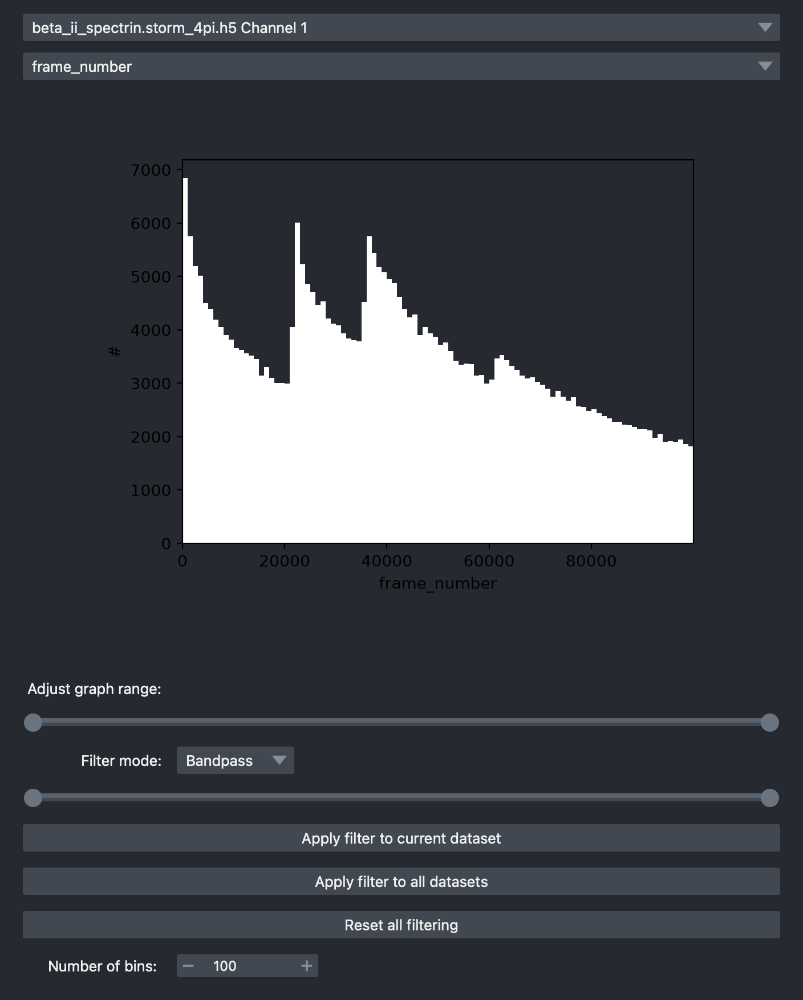
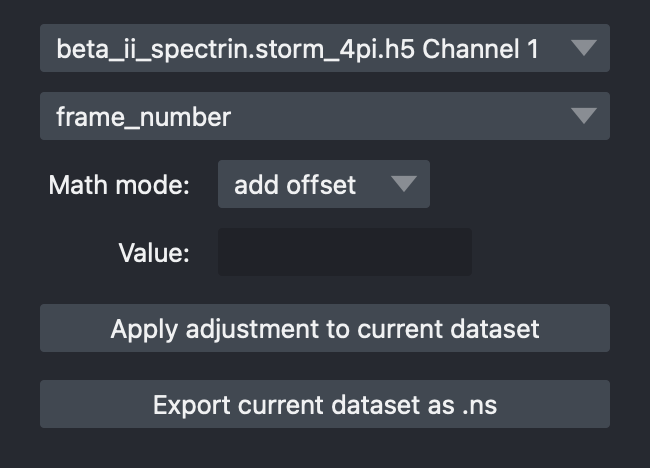

# Filtering and adjusting

## Filtering

{ .dock align=right }

The **Data Filter** tab hides localizations by the value of any property the
data has -- photons, precision, frame, sigma, `efo`, `cfr`, x, y or z.

1. Choose the dataset, then the property. The histogram shows its
   distribution; **Number of bins:** sets its resolution, and
   **Adjust graph range:** zooms the histogram onto part of it.
2. Choose a **Filter mode:** -- **Bandpass** keeps what lies inside the range,
   **Bandstop** what lies outside -- and set the range with the slider below
   the histogram.
3. Press **Apply filter to current dataset**, or
   **Apply filter to all datasets** to apply the same range to every loaded
   dataset.

Filters accumulate: apply one on photons and another on precision, and only
localizations passing both are drawn. **Reset all filtering** brings back
everything that was imported.

Filtering never changes or copies your data. It marks localizations as
inactive, which is why applying a filter is fast even on millions of
localizations and why a reset is exact. Exports and the counts in
**File Infos** follow the filters; the render budget does not hide anything
from them.

## Local density

Isolated localizations -- background, stray blinks -- sit far from any
other, while labelled structure is crowded. **Local density** measures that
for every localization: how many *other* localizations lie within the
**Search radius:** of it, in a sphere for 3-D data and a circle for 2-D. It is
the same count daxview uses, with the same default radius of 35 nm.

1. Apply the filters that remove what you do not trust (dim localizations,
   poor precision) first: only localizations that pass the filters applied so
   far count as neighbours. The render range does not limit it, so cropping
   does not make the edges of the view look sparse.
2. Set the **Search radius:** and press **Calculate local density**. Every
   loaded dataset, each channel on its own, gets a `local_density` parameter,
   and the histogram shows it.
3. Filter on it like any other parameter -- a **Bandpass** from a threshold
   upwards keeps the crowded localizations -- or colour by it with
   **Colour code by** on the Render options tab.

Calculating again replaces the values. **Reset all filtering** counts again
with the same radius, now over everything.

## Splitting a dataset in two

Apply a filter, look at what it leaves, and if you like it press
**Split current dataset by last filter**. The current dataset becomes two
channels: what the last filter kept -- what you see now -- named
`<name> in`, and what it removed, `<name> out`. Each has its own colour,
contrast and visibility, and can be filtered further, coloured or exported on
its own. Split after a local density threshold to show the dense and sparse
localizations side by side in two colours.

The two channels replace the original. Localizations removed by filters
applied *before* the last one go to neither part. A dataset is not split
before a filter has been applied to it, when the last filter removed nothing,
while drift correction is applied, or when the local density was calculated
after the last filter (apply the filter again, then split).

A [scene](export.md#scenes) remembers the split: loading it opens the file,
replays the filters and density calculation that came before, and splits it
again into the same two channels.

## Adjusting values

{ .dock align=right }

The **Data adjustment** tab changes a property of the loaded data: choose the
dataset and the property, a **Math mode:** -- **add offset** or
**rescale** -- and a **Value:**, then press
**Apply adjustment to current dataset**. The view updates.

Unlike a filter, an adjustment changes the values held in memory; the file on
disk is not touched. To undo one, apply the inverse (an offset of minus the
value, or a rescale by its reciprocal) or open the file again.

**Export current dataset as .ns** writes the dataset, adjustments included, to
napari-storm's own HDF5 format, which [opens](importing.md) like any other
file.

