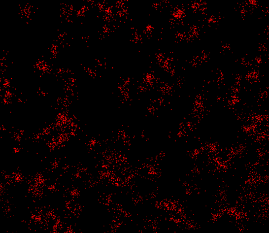
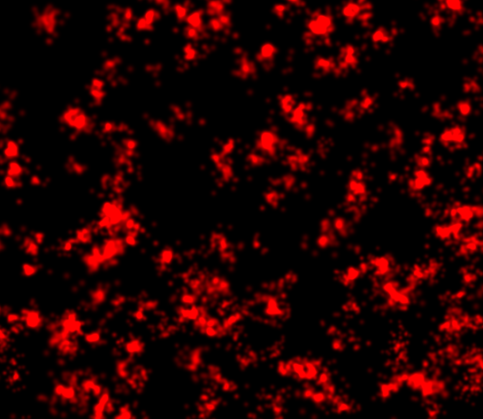
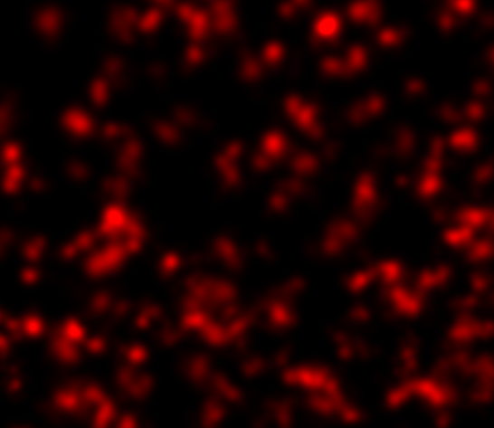
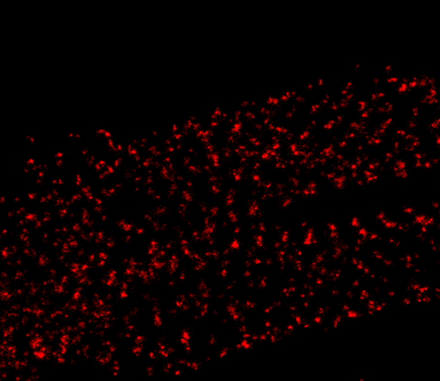
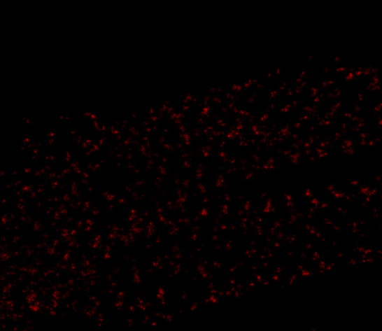
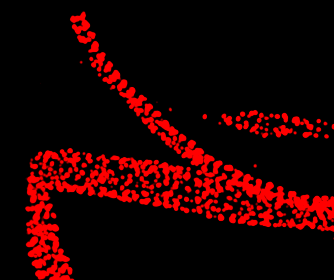

# Rendering and contrast

napari-storm draws every localization as a Gaussian and adds up the
Gaussians where they overlap. Two settings decide what you see: how wide each
Gaussian is, and how the summed image is mapped to brightness.

## Gaussian width

**Rendering options:** in Data Controls offers two modes.

**Fixed-size gaussian** draws every localization at the same width. Set it
with **FWHM in XY [nm]:** and **FWHM in Z [nm]:** -- both default to 20 nm.
The spectrin sample resolves better than 10 nm, so 8 nm is its natural
width:

<div class="gallery wide" markdown>
<figure markdown>

<figcaption>2 nm: below the resolution, the image breaks into specks</figcaption>
</figure>
<figure markdown>

<figcaption>8 nm: close to the resolution</figcaption>
</figure>
<figure markdown>

<figcaption>20 nm, the default: structure blurs together</figcaption>
</figure>
</div>

Choose a width close to the resolution of the data. Wider looks smoother
but shows less than was measured. Each image here is exposed separately, with
×Range set so that the brightest pixels just reach full brightness.

**Variable-size gaussian** draws each localization at its own measured
precision, taken from the uncertainty or photon count in the file. The fields
change meaning:

| Field | Meaning | Default |
|---|---|---|
| **PSF FWHM in XY [nm]** | the width of the microscope's PSF, which the precision is scaled from | 300 |
| **PSF FWHM in Z [nm]** | the same, axially | 700 |
| **Min. FWHM in XY [nm]:** | a floor, so a very precise localization does not shrink to nothing | |
| **Min. FWHM in Z [nm]:** | the floor, axially (3-D data only) | |

Variable size is only offered when every loaded dataset is STORM/PALM data;
with MINFLUX or plain localizations loaded, the menu returns to
**Fixed-size gaussian**. A localization with neither an uncertainty nor a
photon count is drawn at the floor. Switching modes puts the width fields
back to that mode's defaults, and switches depth colouring off -- it is not
available in variable mode.

!!! note "Widths are FWHM, not σ"

    Every width field is a full width at half maximum in nanometres. The
    renderer works in σ and converts for you (σ = FWHM / 2.355). If you have
    a σ in mind, multiply it by 2.355 first: a 30 nm σ is a 70.6 nm FWHM.

**A size safety cap.** The cost of drawing a Gaussian grows with the area it
covers on screen, regardless of how many there are, so a few enormous ones can
stall the GPU. Each is therefore clamped to half the field of view, and a
notification says when that happened. Only the faint outer tail of a
Gaussian already much larger than the screen is lost.

## Contrast

Each dataset's card in Data Controls has a two-handle contrast slider with two
boxes beneath it, **Cutoff** and **×Range**. They act on the reconstruction
itself -- the sum of the Gaussians -- so with fixed-size Gaussians their
numbers count overlapping localizations:

* **×Range**, the right handle, is how many overlapping localizations it
  takes to reach full brightness. The default, 1, brings the centre of a
  single Gaussian to full brightness: right for sparse data, while dense
  data clips to flat colour. Raise it until the densest parts keep their
  detail.
* **Cutoff**, the left handle, hides everything where fewer localizations
  overlap than this. At 2, a lone localization disappears while clusters
  stay.

<div class="gallery wide" markdown>
<figure markdown>

<figcaption>×Range set so the densest pixels just reach full brightness</figcaption>
</figure>
<figure markdown>

<figcaption>×Range 2.5 times higher: sparse localizations fade</figcaption>
</figure>
<figure markdown>

<figcaption>As the first, with Cutoff 1.2: lone localizations drop out</figcaption>
</figure>
</div>

Both handles share one logarithmic scale from 0.01 to 100; type exact values
into the boxes. With variable-size Gaussians each localization contributes
according to its precision rather than counting as one.

Rendering styles that draw opaque markers instead of Gaussians have no sum
to act on. With those the slider maps each marker's own value onto the
colormap, and it keeps separate handle positions for when you switch back.
See [Rendering styles](styles.md).

## Colour

The **colormap** menu in each card offers red, green, blue, yellow, cyan,
pink, orange, mint, purple, gray and red hot. Choosing different colormaps for
different datasets is how channels are told apart.

**Colour code by** colours every localization by one property instead: x, y,
z (depth), or any numeric column the loaded datasets share, such as frame,
photons or uncertainty. 2-D data can be colour coded too, by anything but z.
While it is on, each card's colormap menu gives way to an opacity slider, and a
colour bar appears in Data Controls with:

* a **colormap** menu: HSV (rainbow, the default), grey, viridis, magma,
  plasma, turbo, and the diverging cool-warm, blue-white-red, red-white-blue
  and pink-white-green, which put the middle of the range at a neutral colour;
* the **limits** -- the property values at the two ends of the bar. One pair
  holds for every dataset. With **Auto** ticked they follow the data: an axis
  spans the render-range window, any other property the 1st to 99th
  percentile of the selected localizations. Type a value into either end to
  fix them; values beyond a limit take the colour at that end.

Where localizations overlap, their colours blend to the average rather than
adding up, so a dense region keeps its colour instead of turning white. The
card's contrast slider still works while colour coding: it sets brightness
from how many localizations overlap, just as without colour coding, and an
opacity slider sits beside it for overlaying channels. Opaque rendering
styles colour each marker on its own and have no contrast slider.

Colour coding is not available with variable-size Gaussians, whose values
carry the intensity weighting. It is saved in [scenes](export.md#scenes).

## How much is drawn

Drawing costs host memory -- 28 bytes per localization on the usual renderer,
304 on the fallback one -- before napari's and the GPU's own copies. To keep a
very large import from exhausting memory, napari-storm draws at most a 2 GB
budget's worth, roughly 6.7 million localizations shared between all loaded
datasets. Beyond that it draws an evenly spaced subsample and says how many of
your localizations are on screen. All of them stay loaded: filters and exports
still use the full dataset.

Set `NAPARI_STORM_RENDER_BUDGET_MB` before starting napari to change the
budget, or set it to `0` to remove it:

```bash
NAPARI_STORM_RENDER_BUDGET_MB=8192 napari-storm
```

## Screen and export

The canvas is a display. It cuts each Gaussian at three σ and ends in an 8-bit
framebuffer, so very dense regions clip on screen. The
[OME-TIFF export](export.md) evaluates each Gaussian to five σ in floating
point, and is the image to measure.
